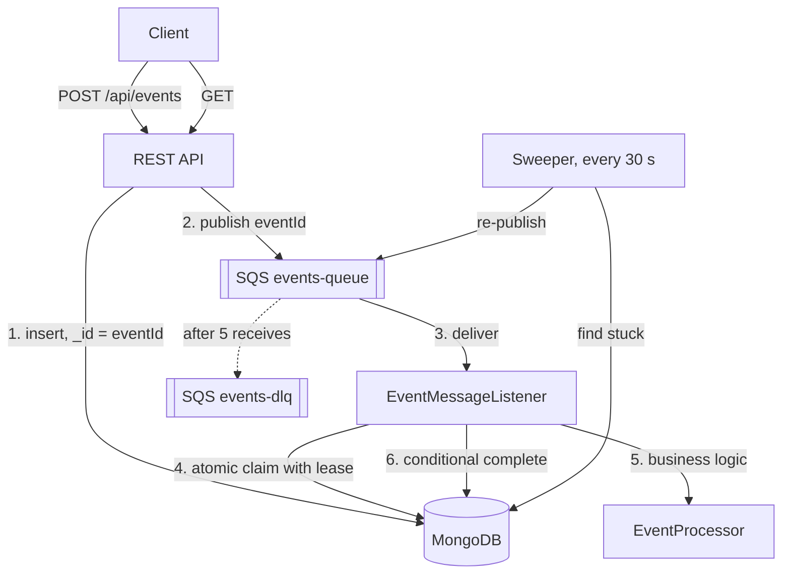

# Architecture

## Overview

The service takes events over REST, saves them in MongoDB and hands them to a worker through an SQS queue. MongoDB holds the state of every event. The queue only carries a "process event X" signal, so a lost, duplicated or dead-lettered message never corrupts state. The worst outcome is a delay until the recovery job sends the signal again.

Correctness rests on three mechanisms:

1. `_id` is the `eventId`, so duplicate or concurrent `POST`s end up as one document.
2. A worker claims an event in one atomic update and holds it on a lease. Only one worker processes an event at a time, and a crashed worker's claim expires.
3. A recovery job (the sweeper) re-publishes events that got stuck, which covers a publish that never happened and a crash mid-processing.



## API contract and assumptions

- `POST /api/events` returns `202 {"eventId", "status": "RECEIVED"}` with a `Location` header pointing to `/api/events/{eventId}`. Sending the same `eventId` with the same payload again returns `202` with the current status, so client retries are safe. The same `eventId` with a different payload returns `409`.
- `GET /api/events/{eventId}` returns the fields from the assignment (`eventId`, `customerId`, `type`, `amount`, `currency`, `status`, `createdAt`, `processedAt`) plus `timestamp` and `failureReason`. `createdAt` is when the service received the event; `timestamp` is when it happened.
- `GET /api/customers/{customerId}/events` filters `from`/`to` on `timestamp` (inclusive, ISO-8601), optionally by `status`, newest first (`timestamp`, then `eventId`). `page` starts at 0, `size` defaults to 20, maximum 100; a larger `size` or `from` after `to` returns `400`. The response is `{"content", "page", "size", "totalElements", "totalPages"}`. A customer with no events gets an empty page, not `404`.
- Event types are `PAYMENT` and `REFUND`. Amounts are positive with at most 2 decimals and 15 integer digits; currency is an ISO 4217 code in upper case. `eventId` and `customerId` are 1 to 64 letters, digits, `_` or `-`. `timestamp` is stored to the millisecond. `metadata` is an optional map of strings with at most 20 entries, keys of 1 to 64 letters, digits, `_` or `-`, and values up to 256 characters; these three bounds are configurable. Currencies with 0 or 3 minor units are a simplification I accepted.
- The business logic is simulated and touches nothing outside MongoDB: amounts above a configurable maximum fail permanently.
- Errors are RFC 7807 `ProblemDetail`: 400 validation, with an `errors` list naming each failing field, 404, 409, 503 when MongoDB is unreachable, and 500 for anything else, without internal details.

## Components

| Package | Responsibility |
| --- | --- |
| `api` | Controllers, request/response DTOs, validation, error handling |
| `application` | `EventService` (create, query), `EventProcessingService` (claim, process, complete) |
| `domain` | `Event`, `EventStatus`, `EventType`, `EventProcessor` (business rule) |
| `persistence` | `EventRepository` (reads, insert), `EventStateStore` (atomic transitions), `IndexInitializer` |
| `messaging` | `EventPublisher`, `EventMessageListener` |
| `recovery` | `StuckEventSweeper` |

## Event lifecycle

```
RECEIVED ──claim──► PROCESSING ──success──────────────────────► PROCESSED
    ▲                   │  │
    │  lease expired    │  └─ permanent error, or attempts exhausted ──► FAILED
    └──(redelivery)─────┘
```

Retries are counted in an `attempts` field instead of extra states.

## Data model and indexes

One document per event in the `events` collection:

```json
{
  "_id": "evt-123456",
  "customerId": "customer-123",
  "type": "PAYMENT",
  "amount": { "$numberDecimal": "1250.50" },
  "currency": "ILS",
  "occurredAt": "2026-09-13T20:15:00Z",
  "metadata": { "source": "mobile", "channel": "app" },
  "payloadHash": "sha256 of the normalised request",
  "status": "PROCESSED",
  "attempts": 1,
  "claimToken": "uuid of the current claim",
  "lockedUntil": "2026-09-13T20:16:02Z",
  "lastPublishedAt": "2026-09-13T20:15:01Z",
  "failureReason": null,
  "createdAt": "2026-09-13T20:15:01Z",
  "updatedAt": "2026-09-13T20:15:02Z",
  "processedAt": "2026-09-13T20:15:02Z"
}
```

`amount` is `BigDecimal` in Java and `Decimal128` in MongoDB, never a float. `payloadHash` is computed over normalised fields, so `1250.5` and `1250.50` count as the same payload.

`IndexInitializer` creates the indexes at startup so they are visible in code:

| Index | Serves |
| --- | --- |
| `_id` (built in, unique) | Lookup by `eventId`, duplicate detection, claim and complete |
| `{customerId: 1, occurredAt: -1, _id: -1, status: 1}` | The customer query, with or without `status` |
| `{status: 1, lastPublishedAt: 1}`, partial on `status ∈ {RECEIVED, PROCESSING}` | The sweeper |

The customer index is ordered so it works whether or not `status` is sent. `customerId` and the `occurredAt` range narrow the scan, `occurredAt` and `_id` give a stable newest-first sort without sorting in memory, and `status` at the end is filtered inside the index without reading documents. Putting `status` second would break the range and sort for the common case where no status is given.

The sweeper index is partial, so it only holds unfinished events and stays small however many events have been processed. Without it the sweeper would scan the whole collection every 30 seconds.

As data grows, point reads and customer queries stay on indexes. Two things degrade: offset paging on deep pages (`skip` walks the index) and the `count` behind the total. The next step is keyset paging on `(occurredAt, _id)`. If sharding becomes necessary, hashed `_id` keeps the uniqueness guarantee; sharding on `customerId` keeps customer queries on one shard but loses global uniqueness of `_id`.

## Processing flow

Create:
1. Validate the request and `insert` it with `status = RECEIVED`.
2. On `DuplicateKeyException`, compare `payloadHash`: same returns the current status, different returns `409`. No check-then-insert, so concurrent duplicates are decided by the unique index.
3. Publish `{eventId}` to SQS and return `202`. If the publish fails, I log it and still return `202`; the sweeper publishes it later.

Process:
1. Claim with one `findAndModify`: match `_id` where the status is `RECEIVED`, or `PROCESSING` with an expired lease, and `attempts < maxAttempts`. Set `PROCESSING`, a new `claimToken`, `lockedUntil = now + 60 s`, and increment `attempts`.
2. No match means the event is done, owned by another worker, or out of attempts: acknowledge and stop.
3. Run the business logic, then complete with a conditional update on `status = PROCESSING` and my `claimToken`. If it matches nothing, my lease expired and another worker owns the event.
4. A permanent business error sets `FAILED` the same way. Any other exception is not caught, so the message is not acknowledged and SQS redelivers it.

Recover (sweeper, every 30 s, using `@Scheduled`):
1. Mark `PROCESSING` events with an expired lease and no attempts left as `FAILED`.
2. Re-publish `RECEIVED` events, and `PROCESSING` events with an expired lease, whose `lastPublishedAt` is older than 2 minutes. Batched, and `lastPublishedAt` is updated so the same event isn't re-sent every run.

## Idempotency

| Duplicate source | What stops it |
| --- | --- |
| Client retries, concurrent `POST`s | Unique `_id` |
| SQS delivers a message twice | Atomic claim; the second delivery matches nothing |
| Sweeper and SQS both resend | Same |
| A worker whose lease expired | `claimToken` check on completion |

The lease makes MongoDB state change exactly once. It can't do that for a call to an external system: a worker could make the call and crash before recording it. Here the business logic has no external side effects and its result is written in the same update that sets `PROCESSED`. If it ever calls another system, `eventId` has to go along as an idempotency key.

## Failure handling and retries

| Scenario | Behaviour |
| --- | --- |
| Permanent business error | `FAILED` with a reason, no retry |
| Transient error in processing | Not acknowledged, redelivered after the visibility timeout |
| MongoDB down during `POST` | `503`; the client retries; nothing is half-written |
| MongoDB down during processing | Redelivered; after 5 receives the message goes to the DLQ, but MongoDB still shows the event unfinished, so the sweeper re-publishes it when MongoDB is back |
| Publish fails after insert | `202`; the sweeper publishes it |
| Duplicate delivery | Claim matches nothing; acknowledged |
| Crash mid-processing | Message redelivered and lease expires, so another worker claims it; if the message is gone, the sweeper re-publishes |
| Poison message | DLQ after 5 receives |

Retry strategy: there are no in-process retries. SQS redelivery is the retry, with a fixed 90-second backoff (the visibility timeout); exponential backoff through `ChangeMessageVisibility` would be the next refinement. An event gets 3 attempts, tracked in MongoDB, and then becomes `FAILED`. The lease (60 s) is shorter than the visibility timeout (90 s), so a redelivered message always finds the old claim expired. `maxAttempts` (3) is lower than the queue's `maxReceiveCount` (5), so MongoDB decides when to give up and the API shows it; the DLQ only collects messages that can't be handled at all.

I check both rules at startup against the real queue: the app reads the visibility timeout and the redrive policy's `maxReceiveCount` of the events queue and refuses to start if the lease isn't shorter than the visibility timeout or `maxAttempts` isn't lower than `maxReceiveCount`.

The DLQ is a redrive policy, so no code moves messages there. Messages in it trigger an alarm. After fixing the cause, the operator redrives them (`StartMessageMoveTask`) or discards them; discarding is safe for valid events because the sweeper will publish them again.

## Decisions and trade-offs

| Decision | Alternative | Why |
| --- | --- | --- |
| SQS Standard as the work queue | Kafka, SQS FIFO | The assignment asks for SQS. For a work queue it also fits better: per-message ack, built-in DLQ and visibility timeout, no partitions to manage. FIFO's deduplication only covers 5 minutes, and idempotency is enforced in MongoDB anyway |
| ElasticMQ for local SQS | LocalStack | Current LocalStack images need an account and auth token, so `docker compose up` would fail for a reviewer. ElasticMQ is SQS-compatible and supports DLQs and visibility timeouts |
| One compound customer index | Two indexes, with and without `status` | One index covers both query shapes at half the write cost |
| Sweeper without a distributed lock | ShedLock | Several sweepers may publish the same event, which is harmless because the claim is atomic and duplicates must be tolerated anyway |
| `202` when the publish fails | Fail the request | The event is stored; failing would make the client retry an event that already exists |
| Single-document atomic updates | MongoDB transactions | Every correctness-critical change touches one document. Transactions would also need a replica set locally |
| Logs and health checks only | Custom Micrometer metrics | Keeps the scope near the 4 to 6 hour estimate; the production metrics are listed under Monitoring |
| Offset paging | Keyset paging | Matches the requested `page`/`size`; keyset is the scaling path |
| Spring Boot 4.x | Spring Boot 3.5 | 3.5 reached end of open-source support in June 2026 |

## Scaling and bottlenecks

The API and the worker are stateless and scale horizontally; one image runs both, and configuration switches the listener or the API off. Workers scale on queue depth.

The likely bottlenecks are MongoDB writes (one insert and two or three updates per event), deep pages for customers with millions of events, and the sweeper during a long backlog, when it re-publishes events that are only waiting. `lastPublishedAt`, the batch size and a `republishAfter` above normal queue latency limit that.

## Adding other consumers

The SQS queue is an internal work queue: its message is a command for this service. If another service, say notifications, needs to react to processed events, the worker should publish an "event processed" fact instead of calling that service directly:

- SNS with one SQS queue per subscriber, when consumers only need new events.
- Kafka on Amazon MSK, when consumers need replay or history.

Either way the publish after `PROCESSED` is a second write, so it needs the same treatment as the queue publish: a "not yet published" flag on the document and a background job that completes it. I haven't built this because nothing in the assignment needs it.

## AWS deployment

ECS on Fargate with two services from one image: `api` behind an ALB and `worker` scaling on queue depth. SQS Standard with redrive to a DLQ, defined in Terraform or CDK. MongoDB Atlas over PrivateLink as a three-zone replica set (DocumentDB would need compatibility testing). The MongoDB URI comes from Secrets Manager and SQS access from the task IAM role, so there are no access keys. Both task roles also need `sqs:GetQueueUrl` and `sqs:GetQueueAttributes` for the startup check. Local credentials and the ElasticMQ endpoint come only from the local setup (Docker Compose, the test containers, or the shell when running on the host), never from the application config, so in ECS the SDK uses the task role. Tasks run in private subnets behind the ALB, which terminates TLS.

## Monitoring

Implemented: JSON logs with `eventId` in the MDC on every line, so one event can be followed from `POST` to `PROCESSED`, and `/actuator/health` including MongoDB.

For production I'd add counters for received, duplicate, processed and failed events, a processing-time histogram and a gauge of stuck events, plus alarms on DLQ depth above zero, `ApproximateAgeOfOldestMessage`, stuck events and the 5xx rate. Tracing with OpenTelemetry, carrying the trace context in SQS message attributes, would join API and worker spans.

## Security

Input is validated at the edge, and `metadata` and page size are bounded. Errors don't expose stack traces. There are no secrets in the repository; `.env.example` lists the variables. The container runs as a non-root user. The API has no authentication; in production it would sit behind OAuth2/JWT or API Gateway, with customers limited to their own events.
