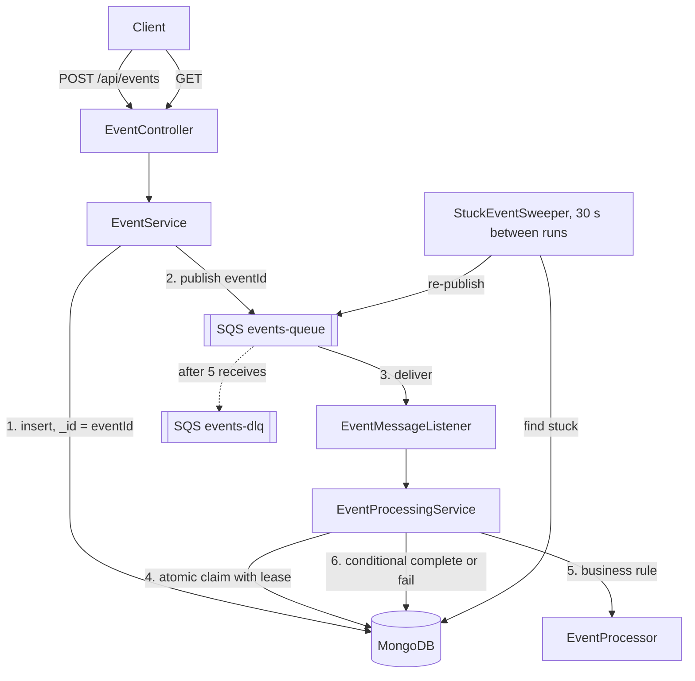

# Architecture

## Overview

The service takes events over REST, saves them in MongoDB and hands them to a worker through an SQS queue. MongoDB holds the state of every event. The queue only carries a "process event X" signal, so a lost, duplicated or dead-lettered message never corrupts state. The worst outcome is a delay until the recovery job sends the signal again.

Correctness rests on three mechanisms:

1. `_id` is the `eventId`, so duplicate or concurrent `POST`s end up as one document.
2. A worker claims an event in one atomic update and holds it on a lease. Only one worker holds the claim at a time, only the current holder can store a result, and a crashed worker's claim expires.
3. A recovery job (the sweeper) re-publishes events that got stuck, which covers a publish that never happened and a crash mid-processing.



## API contract and assumptions

- `POST /api/events` returns `202 {"eventId", "status": "RECEIVED"}` with a `Location` header pointing to `/api/events/{eventId}`. Sending the same `eventId` with the same payload again returns `202` with the current status, so client retries are safe. The same `eventId` with a different payload returns `409`.
- `GET /api/events/{eventId}` returns the fields from the assignment (`eventId`, `customerId`, `type`, `amount`, `currency`, `status`, `createdAt`, `processedAt`) plus `timestamp` and `failureReason`. `createdAt` is when the service received the event; `timestamp` is when it happened.
- `GET /api/customers/{customerId}/events` filters `from`/`to` on `timestamp` (inclusive, ISO-8601), optionally by `status`, newest first (`timestamp`, then `eventId`). `page` starts at 0, `size` defaults to 20, maximum 100; a larger `size`, `from` after `to`, or `page * size` above 10,000 returns `400` (a deeper offset walks that many index keys, so a client with that much history narrows the query with `from` and `to`). The response is `{"content", "page", "size", "totalElements", "totalPages"}`. A customer with no events gets an empty page, not `404`.
- Event types are `PAYMENT` and `REFUND`. Amounts are positive with at most 2 decimals and 15 integer digits; currency is an ISO 4217 code in upper case. `eventId` and `customerId` are 1 to 64 letters, digits, `_` or `-`. `timestamp` must be from 1970 to 9999, a range I chose as plausible for business events (Jackson accepts years up to a billion, which overflow the conversion to a MongoDB date), and is stored to the millisecond, in the `occurredAt` field. `metadata` is an optional map of strings with at most 20 entries, keys of 1 to 64 letters, digits, `_` or `-`, and values up to 256 characters; these three bounds are configurable. I allow 2 decimals for every currency, so currencies with 0 minor units (JPY) or 3 (KWD) are not checked against their real precision.
- The business logic is simulated and touches nothing outside MongoDB: an amount above a configurable maximum (10000.00 by default) fails permanently.
- `GlobalExceptionHandler` returns RFC 7807 `ProblemDetail`: 400 with an `errors` list naming each failing field or query parameter (a body that isn't valid JSON gets 400 without the list), 404, 409, 503 when MongoDB can't be reached within 5 seconds or an operation on it takes longer than 10 seconds (`serverSelectionTimeoutMS` and `timeoutMS` in the URI; any `MONGODB_URI` override, including the production one, must keep both), and 500 for anything else. Spring itself answers an unsupported method with 405, a `Content-Type` other than JSON with 415 and an unknown path with 404, also as `ProblemDetail`, with its own one-line message such as "Method 'PUT' is not supported.". No response carries a stack trace, and apart from those Spring messages none carries a library's exception message.

## Components

| Package | Responsibility |
| --- | --- |
| `api` | `EventController`, request and response records with Bean Validation, `GlobalExceptionHandler`, `EventIdMdcFilter` |
| `application` | `EventService` (create, get, customer query), `EventProcessingService` (claim, run the rule, complete or fail), the `EventPublisher` interface |
| `domain` | `Event`, `NewEvent` (with the payload hash), `EventStatus`, `EventType`, `EventProcessor` (the business rule) |
| `persistence` | `EventRepository` (reads, insert), `EventStateStore` (atomic transitions), `IndexInitializer` |
| `messaging` | `SqsEventPublisher` (implements `EventPublisher`), `EventMessageListener`, `EventMessageErrorHandler`, `QueueSettingsCheck` |
| `recovery` | `StuckEventSweeper` |
| `config` | `EventsProperties` (every limit and timeout except the two MongoDB timeouts, which are options in `MONGODB_URI`, and the events queue name; the DLQ is named only in the queue's redrive policy), the `Clock` |

`domain` depends on nothing else in the app, and `application` doesn't depend on `messaging`: it publishes through its own `EventPublisher` interface. The stack is Java 21, Spring Boot 4.1 with Spring Data MongoDB, Spring Cloud AWS 4.1 for SQS (`SqsTemplate` to send, `@SqsListener` to receive), MongoDB 8.0, and ElasticMQ as SQS locally and in tests.

## Event lifecycle

```
RECEIVED ──claim──► PROCESSING ──success──► PROCESSED
                     │   ▲   │
                     └───┘   └── permanent error, or attempts exhausted ──► FAILED
       lease expired: claimed again, attempts + 1
```

An event never goes back to `RECEIVED`. Retries are counted in an `attempts` field instead of extra states.

## Data model and indexes

One document per event in the `events` collection:

```json
{
  "_id": "evt-123456",
  "customerId": "customer-123",
  "type": "PAYMENT",
  "amount": { "$numberDecimal": "1250.50" },
  "currency": "ILS",
  "occurredAt": "2026-09-13T20:15:00Z",
  "metadata": { "source": "mobile", "channel": "app" },
  "payloadHash": "sha256 of the normalised request",
  "status": "PROCESSED",
  "attempts": 1,
  "claimToken": "uuid of the current claim",
  "lockedUntil": "2026-09-13T20:16:02Z",
  "lastPublishedAt": "2026-09-13T20:15:01Z",
  "createdAt": "2026-09-13T20:15:01Z",
  "updatedAt": "2026-09-13T20:15:02Z",
  "processedAt": "2026-09-13T20:15:02Z",
  "_class": "com.shnol.events.domain.Event"
}
```

`occurredAt` is the API's `timestamp`. `amount` is `BigDecimal` in Java and `Decimal128` in MongoDB, never a float. `failureReason` is only present on a `FAILED` event. `payloadHash` is computed over normalised fields, so `1250.5` and `1250.50` count as the same payload. `_class` is Spring Data's type hint; nothing reads it, because the collection holds one type, and removing it would save about 40 bytes per document.

`IndexInitializer` creates the indexes at startup so they are visible in code:

| Index | Serves |
| --- | --- |
| `_id` (built in, unique) | Lookup by `eventId`, duplicate detection, claim and complete |
| `{customerId: 1, occurredAt: -1, _id: -1, status: 1}` | The customer query, with or without `status` |
| `{status: 1, lastPublishedAt: 1}`, partial on `status ∈ {RECEIVED, PROCESSING}` | The sweeper |

The customer index is ordered so it works whether or not `status` is sent. `customerId` and the `occurredAt` range narrow the scan, `occurredAt` and `_id` give a stable newest-first sort without sorting in memory, and `status` at the end is filtered inside the index without reading documents. Putting `status` second would break the range and sort for the common case where no status is given.

The sweeper index is partial, so it only holds unfinished events and stays small however many events have been processed. Without it the sweeper would scan the whole collection every 30 seconds.

As data grows, point reads and customer queries stay on indexes. Two things degrade: offset paging on deep pages (`skip` walks the index) and the `count` behind the total. The next step is keyset paging on `(occurredAt, _id)`. Events are never deleted, and the duplicate check relies on that; in production I'd archive finished events after a retention period that is longer than any client retry window. If sharding becomes necessary, hashed `_id` keeps the uniqueness guarantee; sharding on `customerId` keeps customer queries on one shard but loses global uniqueness of `_id`.

## Processing flow

Create:
1. Validate the request and `insert` it with `status = RECEIVED`.
2. On `DuplicateKeyException`, compare `payloadHash`: same returns the current status, different returns `409`. No check-then-insert, so concurrent duplicates are decided by the unique index.
3. Publish `{eventId}` to SQS and return `202`. If the publish fails or takes longer than 3 seconds, the service logs it and still returns `202`; the sweeper publishes it later.

Process:
1. Claim with one `findAndModify`: match `_id` where the status is `RECEIVED`, or `PROCESSING` with an expired lease, and `attempts < maxAttempts`. Set `PROCESSING`, a new `claimToken`, `lockedUntil = now + 60 s`, and increment `attempts`.
2. No match means the event is done, owned by another worker, or out of attempts: acknowledge and stop.
3. Run the business logic, then complete with a conditional update on `status = PROCESSING` and the worker's `claimToken`. If it matches nothing, the worker's lease expired and another worker owns the event.
4. A permanent business error sets `FAILED` the same way. Any other exception is not caught: the listener's error handler logs it with `eventId` and rethrows, so the message is not acknowledged and SQS redelivers it.

Recover (`StuckEventSweeper`, `@Scheduled` with 30 s between runs; `SWEEPER_ENABLED=false` turns it off on an instance):
1. Mark `PROCESSING` events with an expired lease and no attempts left as `FAILED` with "max attempts exceeded", in one `updateMany`. A lease that is still held is never matched. Because it is one update, this transition is logged as a count per run, not per event.
2. Re-publish up to 100 `RECEIVED` events, and `PROCESSING` events with an expired lease, whose `lastPublishedAt` is older than 2 minutes. After each publish, a conditional update sets `lastPublishedAt` to now unless the event has finished or another sweeper already did, so the same event isn't re-sent every run. A publish failure ends the run and the next run continues.

Each run that completes logs how many events it failed and re-published. Interval, age and batch size are configurable.

## Idempotency and race conditions

| Duplicate or race | What stops it |
| --- | --- |
| Client retries, concurrent `POST`s | Unique `_id` |
| SQS delivers a message twice, or two workers get it at once | Atomic claim; only one `findAndModify` matches |
| Sweeper and SQS both resend | Same |
| A worker whose lease expired finishes late | `claimToken` check on completion |
| Sweeper fails an event while a worker is on its last attempt | The sweeper only matches an expired lease |
| Two sweepers re-publish the same event | Harmless; `lastPublishedAt` is moved only if no one moved it since the read |

The lease makes MongoDB state change exactly once. It can't do that for a call to an external system: a worker could make the call and crash before recording it. Here the business logic has no external side effects and its result is written in the same update that sets `PROCESSED`. If it ever calls another system, `eventId` has to go along as an idempotency key.

## Failure handling and retries

| Scenario | Behaviour |
| --- | --- |
| Permanent business error | `FAILED` with a reason, no retry |
| Transient error in processing | Logged with `eventId`, not acknowledged, redelivered after the visibility timeout |
| Attempts exhausted | Once the last lease expires, the sweeper marks the event `FAILED` with "max attempts exceeded" |
| MongoDB down or not answering during `POST` | `503` within 5 or 10 seconds; the client retries; nothing is half-written. The same operation timeout keeps a hung MongoDB from blocking workers and the sweeper |
| MongoDB down during processing | Redelivered; after 5 receives the message goes to the DLQ, but MongoDB still shows the event unfinished, so the sweeper re-publishes it when MongoDB is back |
| Publish fails after insert, or SQS doesn't answer within 3 s | Logged at WARN, `202`; the sweeper publishes it once `lastPublishedAt` is older than 2 minutes. The 3 s bound (`PUBLISH_TIMEOUT`) is on the send only, not on the shared SQS client, because a client-wide timeout shorter than the listener's long poll would break receiving |
| Duplicate delivery | Claim matches nothing; acknowledged |
| Crash mid-processing | Message redelivered and lease expires, so another worker claims it; if the message is gone, the sweeper re-publishes |
| Poison message (not JSON, or no `eventId`) | Not acknowledged; DLQ after 5 receives |

Retry strategy: there are no in-process retries. SQS redelivery is the retry, with a fixed 90-second backoff (the visibility timeout); exponential backoff through `ChangeMessageVisibility` would be the next refinement. An event gets 3 attempts, tracked in MongoDB, and then becomes `FAILED`. The lease (60 s) is shorter than the visibility timeout (90 s), so a redelivery normally finds the old claim expired. That isn't guaranteed: the lease starts at the claim and the visibility timeout at the receive, so if more than 30 s pass between the two (a stalled MongoDB, a long GC pause), the redelivery finds the lease still held, its claim matches nothing and the message is acknowledged. If the first worker then fails, no message is left. What guarantees takeover is the lease expiring and the sweeper re-publishing the event, so at least one instance must run the sweeper. `maxAttempts` (3) is lower than the queue's `maxReceiveCount` (5), so MongoDB decides when to give up and the API shows it; the DLQ only collects messages that can't be handled at all.

`QueueSettingsCheck` enforces both rules at startup against the real queue: it reads the events queue's visibility timeout and redrive policy, and the app refuses to start if SQS can't be reached or the queue doesn't exist, the queue has no redrive policy, the lease isn't shorter than the visibility timeout, or `maxAttempts` isn't lower than `maxReceiveCount`.

Lease checks compare `lockedUntil`, written from one instance's clock, with another instance's clock. I assume the instances are NTP-synchronised: normal skew is milliseconds, far below the 60 s lease. An instance running more than 60 s ahead could take over a live lease; the claim token still keeps one result, but the work is wasted and the sweeper could mark the event `FAILED` early. Comparing against MongoDB's `$$NOW` in pipeline updates would remove the assumption.

The DLQ is a redrive policy, so no code moves messages there. In production an alarm on its depth tells an operator, who fixes the cause and then redrives the messages (`StartMessageMoveTask`) or discards them; discarding is safe for valid events because the sweeper will publish them again.

## Decisions and trade-offs

| Decision | Alternative | Why |
| --- | --- | --- |
| SQS Standard as the work queue | Kafka, SQS FIFO | The assignment asks for SQS. For a work queue it also fits better: per-message ack, built-in DLQ and visibility timeout, no partitions to manage. FIFO's deduplication only covers 5 minutes, and idempotency is enforced in MongoDB anyway |
| ElasticMQ for local SQS | LocalStack | Current LocalStack images need an account and auth token, so `docker compose up` would fail for a reviewer. ElasticMQ is SQS-compatible and supports DLQs and visibility timeouts |
| One compound customer index | Two indexes, with and without `status` | One index covers both query shapes at half the write cost |
| Sweeper without a distributed lock | ShedLock | Several sweepers may publish the same event, which is harmless because the claim is atomic and duplicates must be tolerated anyway |
| `202` when the publish fails | Fail the request | The event is stored; failing would make the client retry an event that already exists |
| Single-document atomic updates | MongoDB transactions | Every correctness-critical change touches one document. Transactions would also need a replica set locally |
| Logs and health checks only | Custom Micrometer metrics | Keeps the scope near the 4 to 6 hour estimate; the production metrics are listed under Monitoring |
| Offset paging | Keyset paging | Matches the requested `page`/`size`; keyset is the scaling path |
| Spring Boot 4.1 | Spring Boot 3.5 | 3.5 reached end of open-source support in June 2026 |
| Spring Cloud AWS 4.1.1 on Boot 4.1.3 | Boot 4.0.x, which 4.1.1 is built against | No release documents Boot 4.1, so I tested it: a round-trip test sends with `SqsTemplate` and receives with `@SqsListener`, with Jackson 3 converting the body both ways. No Jackson 2 bridge is needed |

## Scaling and bottlenecks

The API and the worker are stateless and scale horizontally from one image. `SQS_LISTENER_ENABLED=false` makes an instance publish events without consuming them, and `SWEEPER_ENABLED=false` turns its sweeper off. Workers scale on queue depth.

The likely bottlenecks are MongoDB writes (one insert and two or three updates per event), deep pages for customers with millions of events, and the sweeper during a long backlog, when it re-publishes events that are only waiting. `lastPublishedAt`, the batch size and a `republishAfter` above normal queue latency limit that.

The queue is an internal work queue: its message is a command for this service. If another service needs to react to processed events, I'd publish an "event processed" fact to SNS, or to Kafka on MSK if consumers need replay. That publish is a second write after `PROCESSED`, so it would need the same treatment as the queue publish: a "not yet published" flag and a background job that completes it.

## Testing

Unit tests with Mockito cover the decisions inside a class. Everything that depends on MongoDB or SQS behaviour runs against real MongoDB 8.0 and ElasticMQ in Testcontainers: duplicate `POST`s, concurrent claims, stale tokens, index use (checked with `explain`), redelivery, the sweeper and the DLQ. The ElasticMQ test container loads the production `elasticmq.conf` unchanged, plus `fast-events-queue` with a 2-second visibility timeout and the same redrive to its own DLQ after 5 receives. Recovery tests use it with a 1-second lease, so redelivery and dead-letter cases take seconds and still pass the startup check. `./mvnw verify` fails below 80% line coverage.

## AWS deployment

ECS on Fargate with two services from one image: `api` behind an ALB, with `SQS_LISTENER_ENABLED=false` and `SWEEPER_ENABLED=false`, and `worker` scaling on queue depth and running the sweeper. Several sweepers are safe, so the worker needs no single-instance rule. SQS Standard with redrive to a DLQ, defined in Terraform or CDK. MongoDB Atlas over PrivateLink as a three-zone replica set (DocumentDB would need compatibility testing). The MongoDB URI comes from Secrets Manager, with the same `serverSelectionTimeoutMS` and `timeoutMS` options as the local one, and SQS access from the task IAM role, so there are no access keys. Both task roles also need `sqs:GetQueueUrl` and `sqs:GetQueueAttributes` for the startup check. Local credentials and the ElasticMQ endpoint come only from the local setup (Docker Compose, the test containers, or the shell when running on the host), never from the application config, so in ECS the SDK uses the task role. Tasks run in private subnets behind the ALB, which terminates TLS.

## Monitoring

Implemented: JSON logs with `eventId` in the MDC on every line the service writes while creating, processing or re-publishing an event, so one event can be followed from `POST` to `PROCESSED`, and `/actuator/health` including MongoDB. When processing throws, the service logs the failure with `eventId` and the message stays on the queue; Spring Cloud AWS then writes its own "Error processing message" line with the stack trace, which carries only the SQS message id. A body that can't be converted to a message with an `eventId` is logged by the framework, which includes the body, and is left on the queue until it goes to the DLQ.

For production I'd add counters for received, duplicate, processed and failed events, a processing-time histogram and a gauge of stuck events, plus alarms on DLQ depth above zero, `ApproximateAgeOfOldestMessage`, stuck events and the 5xx rate. Tracing with OpenTelemetry, carrying the trace context in SQS message attributes, would join API and worker spans.

## Security

Input is validated at the edge, and `metadata` and page size are bounded. Errors don't expose stack traces. There are no secrets in the repository; `.env.example` lists the variables. The container runs as a non-root user. The API has no authentication; in production it would sit behind OAuth2/JWT or API Gateway, with customers limited to their own events.
